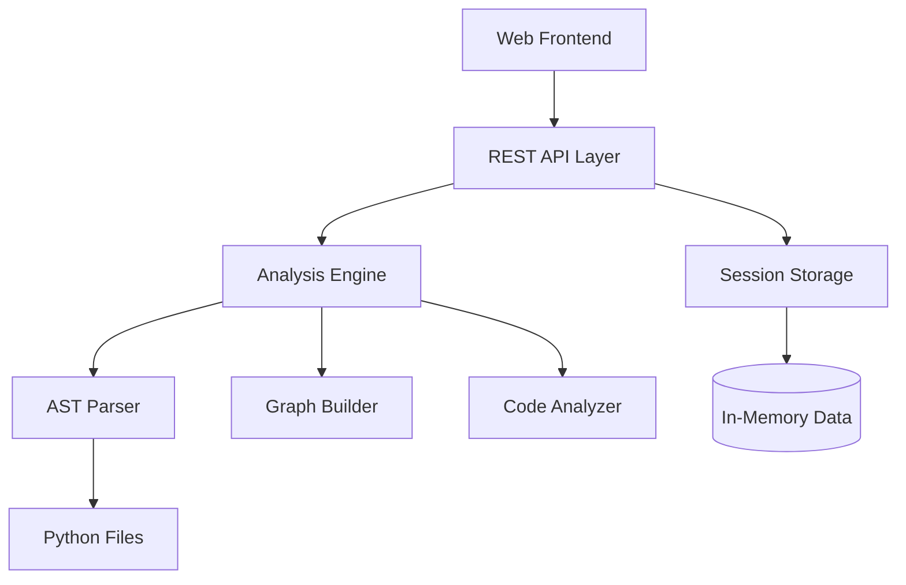

# Design Document

## Overview

The Python Code Analyzer is a web-based application that provides visual exploration of Python projects through interactive mind maps, architectural diagrams, and detailed code relationship analysis. The system uses a multi-layered architecture with a Python backend for static analysis and a modern web frontend for visualization.

The application follows a client-server architecture where the backend performs intensive code analysis using AST parsing and graph algorithms, while the frontend provides rich interactive visualizations optimized for visual thinkers. The design emphasizes scalability, progressive disclosure, and intuitive user experience.

## Architecture

### High-Level Architecture



### Technology Stack

**Backend:**
- **FastAPI**: High-performance web framework for REST API
- **Python AST**: Built-in Abstract Syntax Tree parsing
- **NetworkX**: Graph analysis and algorithms
- **In-memory storage**: Session-based data storage without persistence
- **Threading**: Multi-threaded processing for large projects

**Frontend:**
- **React**: Component-based UI framework
- **D3.js**: Custom interactive visualizations
- **Cytoscape.js**: Graph visualization library
- **Material-UI**: Consistent design system
- **React Query**: Data fetching and caching

**Analysis Libraries:**
- **ast**: Python's built-in AST parser
- **astroid**: Enhanced AST analysis
- **rope**: Python refactoring library for advanced analysis
- **mypy**: Type analysis integration

## Components and Interfaces

### 1. Analysis Engine (`analysis_engine/`)

**Core Responsibilities:**
- Orchestrate the entire analysis pipeline
- Manage parallel processing of large codebases
- Handle progress tracking and error recovery

**Key Classes:**
```python
class ProjectAnalyzer:
    def analyze_project(self, project_path: str) -> AnalysisResult
    def get_analysis_progress(self, analysis_id: str) -> ProgressInfo
    
class AnalysisResult:
    project_info: ProjectInfo
    dependency_graph: DependencyGraph
    code_elements: Dict[str, CodeElement]
    architectural_patterns: List[ArchitecturalPattern]
```

### 2. AST Parser (`parsers/`)

**Core Responsibilities:**
- Parse Python files into AST representations
- Extract code elements (classes, functions, imports)
- Handle syntax errors gracefully

**Key Classes:**
```python
class PythonASTParser:
    def parse_file(self, file_path: str) -> FileAST
    def extract_elements(self, ast_node) -> List[CodeElement]
    
class CodeElement:
    name: str
    type: ElementType  # CLASS, FUNCTION, VARIABLE, etc.
    location: SourceLocation
    dependencies: List[str]
    metadata: Dict[str, Any]
```

### 3. Graph Builder (`graph/`)

**Core Responsibilities:**
- Build dependency graphs from parsed code
- Detect circular dependencies
- Calculate graph metrics and centrality

**Key Classes:**
```python
class DependencyGraphBuilder:
    def build_graph(self, code_elements: List[CodeElement]) -> DependencyGraph
    def detect_cycles(self) -> List[CyclicDependency]
    def calculate_metrics(self) -> GraphMetrics

class DependencyGraph:
    nodes: Dict[str, GraphNode]
    edges: List[GraphEdge]
    metrics: GraphMetrics
```

### 4. Code Analyzer (`analyzers/`)

**Core Responsibilities:**
- Identify architectural patterns
- Detect code smells and unused code
- Analyze inheritance hierarchies

**Key Classes:**
```python
class ArchitecturalPatternDetector:
    def detect_patterns(self, graph: DependencyGraph) -> List[ArchitecturalPattern]
    
class CodeQualityAnalyzer:
    def analyze_quality(self, elements: List[CodeElement]) -> QualityReport
    
class InheritanceAnalyzer:
    def build_hierarchy(self, classes: List[ClassElement]) -> InheritanceTree
```

### 5. API Layer (`api/`)

**Core Responsibilities:**
- Expose REST endpoints for frontend
- Handle authentication and rate limiting
- Manage analysis job queuing

**Key Endpoints:**
```python
POST /api/analyze - Analyze project and return results
POST /api/reset - Clear current analysis and reset to clean state
GET /api/mindmap - Get mind map data for current analysis
GET /api/architecture - Get architectural overview for current analysis
GET /api/search - Search code elements in current analysis
```

### 6. Frontend Components (`frontend/`)

**Core Components:**
- **ProjectInput**: File path input and validation
- **AnalysisProgress**: Real-time progress tracking
- **MindMapViewer**: Interactive mind map visualization
- **ArchitectureViewer**: Architectural diagram display
- **CodeExplorer**: Detailed code element browser
- **SearchInterface**: Global search and filtering

## Data Models

### Core Data Structures

```python
@dataclass
class ProjectInfo:
    name: str
    path: str
    total_files: int
    total_lines: int
    languages: List[str]
    analysis_timestamp: datetime

@dataclass
class SourceLocation:
    file_path: str
    line_number: int
    column_number: int
    end_line: int
    end_column: int

@dataclass
class CodeElement:
    id: str
    name: str
    type: ElementType
    location: SourceLocation
    docstring: Optional[str]
    parameters: List[Parameter]
    return_type: Optional[str]
    decorators: List[str]
    dependencies: List[str]
    usages: List[Usage]

@dataclass
class Usage:
    location: SourceLocation
    context: str
    usage_type: UsageType  # CALL, IMPORT, INHERITANCE, etc.

@dataclass
class ArchitecturalPattern:
    name: str
    type: PatternType
    confidence: float
    elements: List[str]
    description: str
```

### In-Memory Data Structure

```python
# Session-based storage for current analysis
class AnalysisSession:
    project_info: ProjectInfo
    modules: Dict[str, ModuleInfo]
    classes: Dict[str, ClassInfo]
    functions: Dict[str, FunctionInfo]
    dependency_graph: NetworkXGraph
    architectural_patterns: List[ArchitecturalPattern]
    
    def reset(self) -> None:
        """Clear all analysis data and return to clean state"""
```

## Error Handling

### Basic Error Handling

**AST Parsing Errors**
- **Strategy**: Skip files with syntax errors and continue processing
- **Implementation**: Simple try-catch around AST parsing with logging
- **User Experience**: Show count of skipped files in results

```python
def parse_file(self, file_path: str) -> Optional[FileAST]:
    try:
        with open(file_path, 'r') as f:
            return ast.parse(f.read())
    except SyntaxError as e:
        print(f"Skipping {file_path}: Syntax error - {e}")
        return None
    except Exception as e:
        print(f"Skipping {file_path}: Error - {e}")
        return None
```

## Session Management

### Reset Functionality
The application provides a clean reset mechanism to return to initial state:

```python
class SessionManager:
    def reset_analysis(self) -> None:
        """Clear all current analysis data and return to clean state"""
        self.current_session = None
        self.clear_memory_cache()
        self.reset_ui_state()
    
    def analyze_new_project(self, project_path: str) -> AnalysisSession:
        """Start fresh analysis of a new project"""
        self.reset_analysis()
        return self.analyze_project(project_path)
```

### Memory Management
- **Automatic Cleanup**: Clear previous analysis data when starting new analysis
- **Memory Monitoring**: Track memory usage and implement cleanup when needed
- **Session Isolation**: Each analysis session is completely independent

## Scalability Considerations

### Backend Scalability
- **Stateless Design**: Each analysis is independent with no persistent state
- **Multi-threading**: Use threading for parallel file processing
- **Memory Optimization**: Efficient data structures and garbage collection
- **Session-based Caching**: In-memory caching for current analysis only

### Frontend Scalability
- **Virtual Scrolling**: Handle large lists efficiently
- **Lazy Loading**: Load visualization data on-demand
- **Progressive Enhancement**: Start with basic views, enhance with interactions
- **Memory Management**: Proper cleanup of D3.js visualizations

### Data Management
- **Pagination**: Implement cursor-based pagination for large datasets
- **Compression**: Compress large graph data for network transfer
- **Session Reset**: Complete cleanup between different project analyses
- **Memory Efficiency**: Optimize data structures for single-session usage